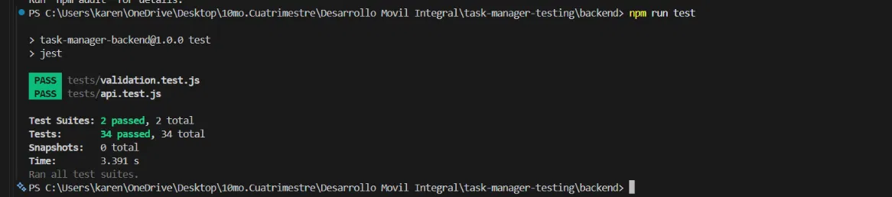
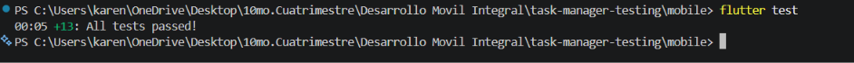
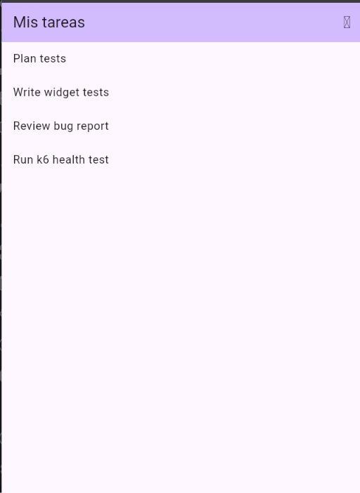

# Task Manager — Evidencia de pruebas de software

Repositorio de práctica basado en la guía **"Become a Better Application Tester: A Hands-On Task Manager Guide"**. Reúne pruebas automatizadas, documentación de pruebas y CI para una app de tareas (Flutter + API Node.js/Express).

> **Alcance y límites:** la API de este repo es una versión mínima con **almacén en memoria** (sustituye a PostgreSQL) y **tokens de prueba** (sustituyen a JWT con refresh). Sirve para practicar y demostrar las técnicas de prueba sin depender de servicios externos. Todo se prueba solo en local con datos sintéticos.

## Estructura y relación con la guía

| Sección de la guía | Dónde está la evidencia |
|---|---|
| 1. Mentalidad y plan | [`docs/01-test-plan.md`](docs/01-test-plan.md), [`docs/02-acceptance-criteria.md`](docs/02-acceptance-criteria.md) |
| 2. Casos de prueba y reportes de bug | [`docs/03-test-cases.md`](docs/03-test-cases.md), [`docs/04-bug-report.md`](docs/04-bug-report.md) |
| 3. Exploración con charter | [`docs/05-exploratory-notes.md`](docs/05-exploratory-notes.md) |
| 4. Pruebas unitarias | [`backend/tests/validation.test.js`](backend/tests/validation.test.js), [`mobile/test/task_test.dart`](mobile/test/task_test.dart) |
| 5. Pruebas de widgets | [`mobile/test/task_list_panel_test.dart`](mobile/test/task_list_panel_test.dart) |
| 6. API e integración | [`backend/tests/api.test.js`](backend/tests/api.test.js) |
| 7. Flujo completo (end-to-end) | [`docs/11-e2e-journey.md`](docs/11-e2e-journey.md) |
| 8. Valores límite | [`docs/06-boundary-values.md`](docs/06-boundary-values.md) |
| 9. Seguridad básica | [`docs/07-security-notes.md`](docs/07-security-notes.md) + pruebas de propiedad en `api.test.js` |
| 10. Rendimiento | [`perf/health-test.js`](perf/health-test.js), [`docs/12-performance-k6.md`](docs/12-performance-k6.md) |
| 11. Accesibilidad | [`docs/08-accessibility-notes.md`](docs/08-accessibility-notes.md) |
| 12. Compatibilidad | [`docs/09-device-matrix.md`](docs/09-device-matrix.md) |
| 13. Humo y regresión | [`docs/10-regression-checklist.md`](docs/10-regression-checklist.md) |
| 14. CI | [`.github/workflows/tests.yml`](.github/workflows/tests.yml) |
| Evidencia de ejecución | [`docs/evidence/`](docs/evidence/) |

## Cómo ejecutar las pruebas

### Backend (Node.js 22)
```bash
cd backend
npm install
npm test
```
Resultado de la última ejecución: ver [`docs/evidence/backend-test-output.txt`](docs/evidence/backend-test-output.txt).

### Flutter
```bash
cd mobile
flutter pub get
flutter test
```

### Rendimiento (k6, solo local)
```bash
cd backend && npm start                                      # terminal 1
BASE_URL=http://localhost:3000 k6 run perf/health-test.js    # terminal 2 (desde la raíz del repo)
```

## Evidencias

### Pruebas del backend (`npm test`)


### Pruebas de Flutter (`flutter test`)


### Lista de tareas en Flutter


## Integración continua
El workflow de GitHub Actions ejecuta las pruebas del backend y de Flutter en cada pull request y en cada push a `main`.

## Reglas de seguridad respetadas
- Solo entornos locales o dedicados; nada contra producción.
- Datos sintéticos (`*@example.test`); sin tokens ni contraseñas reales en el repo.
- Las pruebas de seguridad y carga se limitan al sistema propio.
